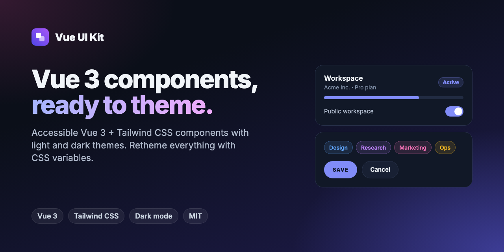
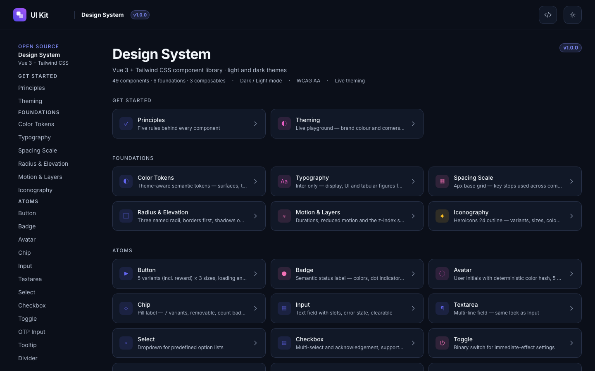
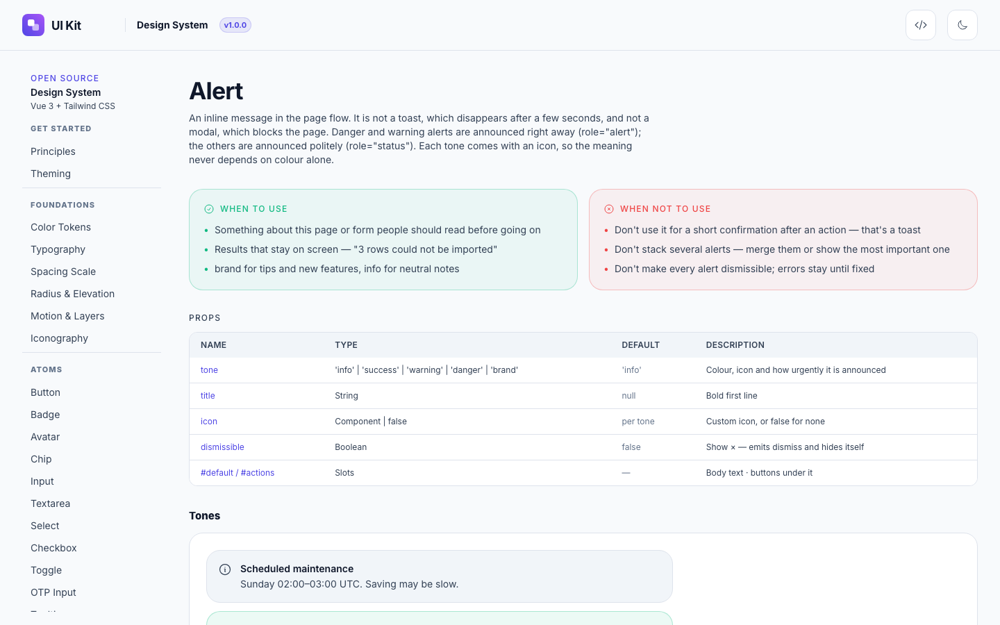

<div align="center">

<a href="https://nebojsab.github.io/vue-ui-kit/"></a>

# Vue UI Kit

**Accessible Vue 3 + Tailwind CSS components with light and dark themes, design tokens and live theming.**

[](https://www.npmjs.com/package/@nebojsab/vue-ui-kit)
[](https://www.npmjs.com/package/@nebojsab/vue-ui-kit)
[](LICENSE)
[](https://nebojsab.github.io/vue-ui-kit/)


[**Live docs**](https://nebojsab.github.io/vue-ui-kit/) · [npm](https://www.npmjs.com/package/@nebojsab/vue-ui-kit) · [Theming playground](https://nebojsab.github.io/vue-ui-kit/theming/) · [Principles](https://nebojsab.github.io/vue-ui-kit/principles/)

</div>

## Why

- **49 components** from buttons to data tables, menus, tabs, drawers and an app shell, each with its own docs page and live demo.
- **Light and dark** from one set of semantic tokens. You write `bg-surface-1`, never `bg-white dark:bg-…`.
- **Retheme in minutes.** Every colour and radius is a CSS variable. Pick a brand colour in the [playground](https://nebojsab.github.io/vue-ui-kit/theming/) and copy the CSS.
- **Accessible by default.** It follows the WAI-ARIA patterns for tabs, menus, dialogs and accordions, has visible focus everywhere and meets WCAG AA contrast in both themes.
- **Tailwind CSS v3 or v4**, plain `<script setup>` source compiled by your own Vite, and **TypeScript declarations** so editors autocomplete props.

| Dark | Light |
|---|---|
|  |  |

## Install

```bash
npm i @nebojsab/vue-ui-kit
```
<sub>Or straight from GitHub: `npm i github:nebojsab/vue-ui-kit`. Peer dependencies: `vue@^3.5`, `@heroicons/vue@^2`, `tailwindcss@^3.4 || ^4`.</sub>

### Tailwind CSS v4

```css
/* src/main.css */
@import "tailwindcss";
@import "@nebojsab/vue-ui-kit/tailwind-v4.css";
```

### Tailwind CSS v3

```js
// tailwind.config.js
import uiKitPreset, { uiKitContent } from '@nebojsab/vue-ui-kit/tailwind-preset'
export default {
  presets: [uiKitPreset],
  content: ['./index.html', './src/**/*.{vue,js,ts}', ...uiKitContent],
}
```
```css
/* src/main.css */
@import '@nebojsab/vue-ui-kit/styles.css';
@tailwind base;
@tailwind components;
@tailwind utilities;
```

### Use it

```vue
<script setup>
import { ref } from 'vue'
import { AppButton, AppTabs, AppAlert, AppToaster, toast } from '@nebojsab/vue-ui-kit'
const tab = ref('overview')
</script>

<template>
  <AppTabs v-model="tab" :tabs="[{ value: 'overview', label: 'Overview' }, { value: 'team', label: 'Team' }]">
    <template #overview>
      <AppAlert tone="success" title="All set">Your workspace is ready.</AppAlert>
      <AppButton @click="toast('Saved')">Save</AppButton>
    </template>
    <template #team>…</template>
  </AppTabs>
  <AppToaster />
</template>
```
```js
// vite.config.js: one copy of Vue
resolve: { dedupe: ['vue', '@heroicons/vue'] }
```
Dark mode: toggle the `dark` class on `<html>`. Wrap a section in `.theme-dark` to keep it dark in both themes.

## What's inside

Organised by [Atomic Design](https://nebojsab.github.io/vue-ui-kit/):

| Level | Components |
|---|---|
| **Foundations** | Colour tokens · Typography (Inter) · Spacing · Radius & elevation · Motion & layers · Iconography (Heroicons) |
| **Atoms** | Button · Badge · Avatar · Chip · Input · Textarea · Select · Checkbox · Toggle · OTP Input · Tooltip · Divider · Spinner · Skeleton · Card |
| **Molecules** | Form Field · Date Input · Combobox · Radio Card · Toggle Group · Copy Button · Tabs · View Tabs · Segment Control · Breadcrumbs · Pagination · Dropdown Menu · Filter Chip · Filter Tile · Alert · Accordion · Stat Card · Info Chip · Progress Bar · Empty State · Period Tabs · Countdown · XP Bar · Reward Box |
| **Organisms** | Modal · Confirm Dialog · Drawer · Popover · Toast · Sidebar · Bottom Nav · Sticky Bar · Back to Top · User Menu · Data Table |
| **Templates** | [Dashboard](https://nebojsab.github.io/vue-ui-kit/template-dashboard/) · [Settings](https://nebojsab.github.io/vue-ui-kit/template-settings/) · [Sign in](https://nebojsab.github.io/vue-ui-kit/template-sign-in/) · [Projects](https://nebojsab.github.io/vue-ui-kit/template-projects/). These are full pages with copy-paste source, previewed at desktop, tablet and phone widths |
| **Extras** | `useInfiniteList` · `useStuck` · `useFloating` · `toast()` · `KitLogo` / `BrandLogo` |

## Theming

Every colour is an RGB-channel CSS variable, and the named radii are variables too. Override them
after the kit's styles:

```css
:root {
  --ui-brand: 5 150 105;          /* r g b — emerald-600 */
  --ui-brand-hover: 4 120 87;
  --ui-radius-card: 0.75rem;
}
html.dark {
  --ui-brand: 52 211 153;
}
```
The [Theming playground](https://nebojsab.github.io/vue-ui-kit/theming/) generates this for any colour.
The tokens include `page`, `surface-1/2/3`, `line`, `fg`, `fg-2`, `fg-muted`, `brand`, `reward`,
`accent-blue/purple/pink/amber` and `success · warning · danger`.

## Develop

```bash
git clone https://github.com/nebojsab/vue-ui-kit.git
cd vue-ui-kit
npm install
npm run dev            # docs on http://localhost:5173, every component live
npm run build:types    # regenerate src/index.d.ts from the components' props
npm run og             # re-render the social preview image
```
The docs live in `docs/` and import the package source directly. Pushing to `main` deploys them
to GitHub Pages, and pushing a `v*` tag publishes the package to npm.

See [CONTRIBUTING.md](CONTRIBUTING.md) and the [changelog](CHANGELOG.md).

## License

[MIT](LICENSE) © Nebojsa Brnjasevic
